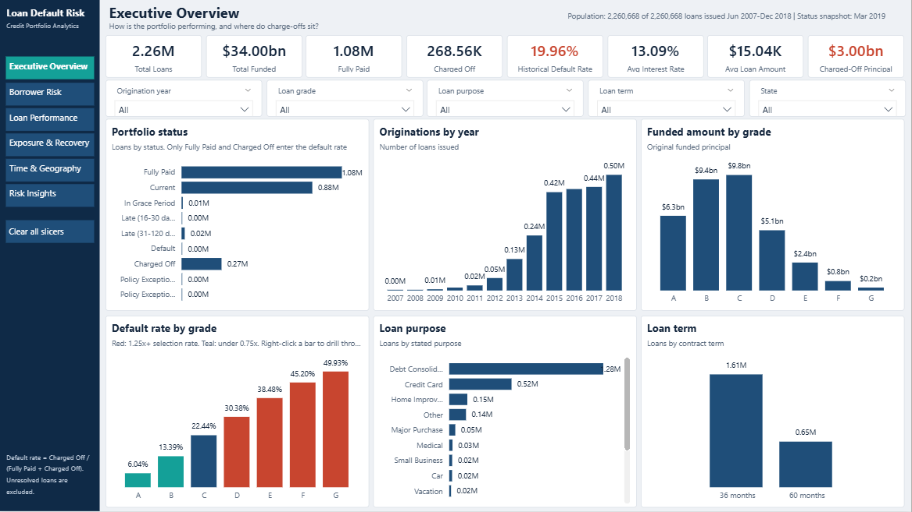
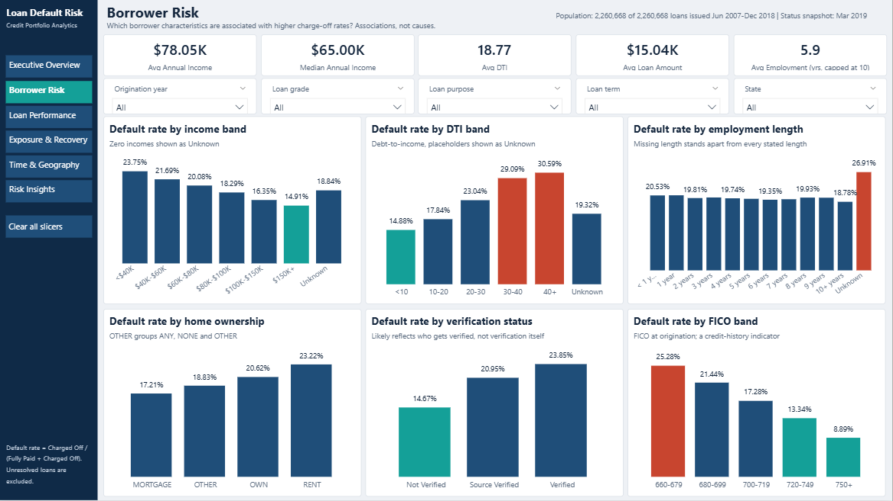
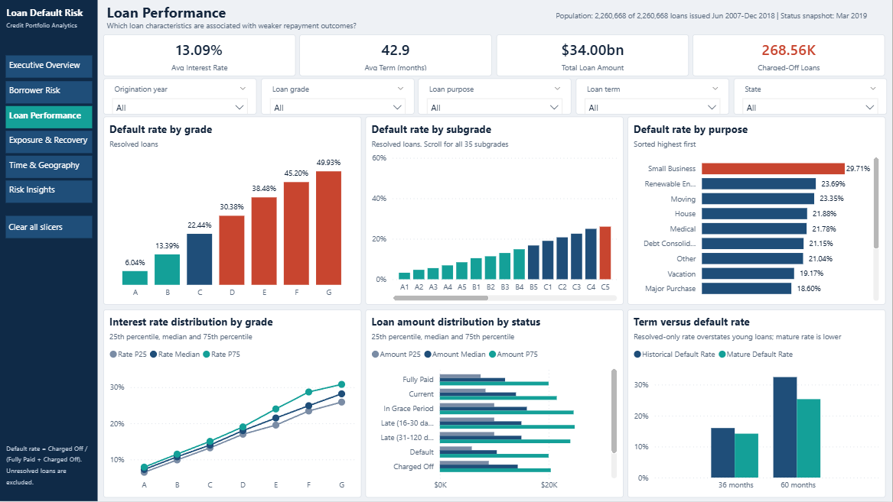
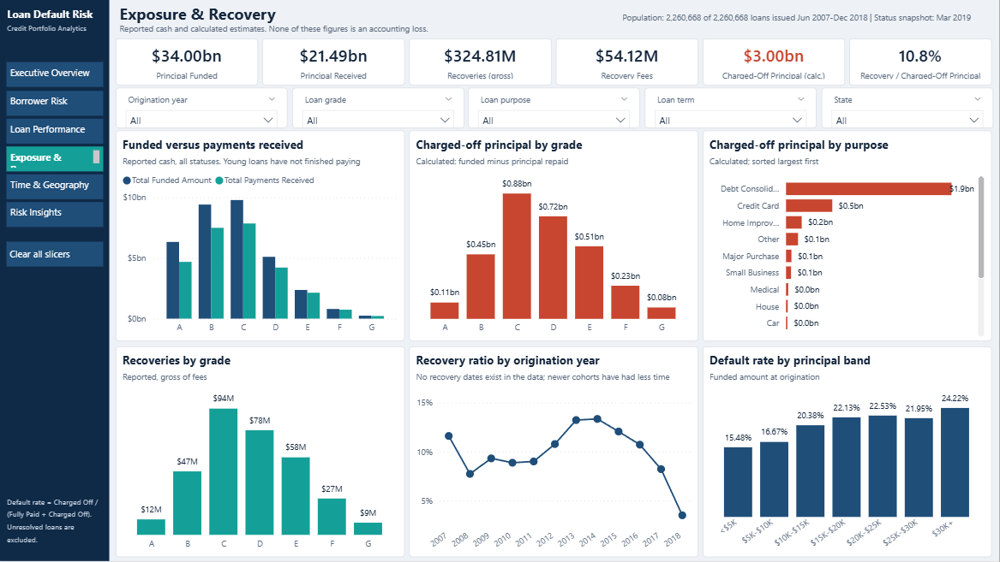
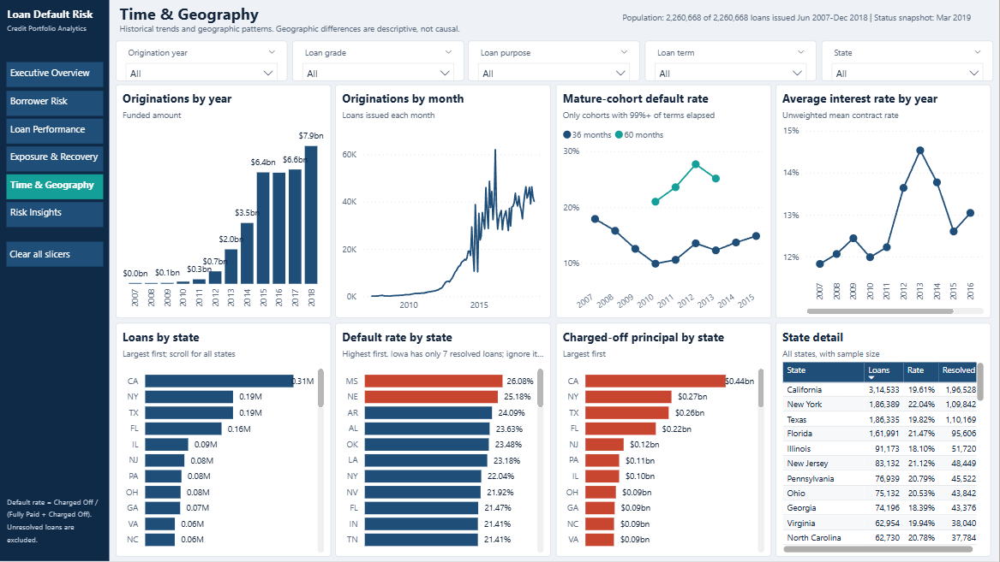
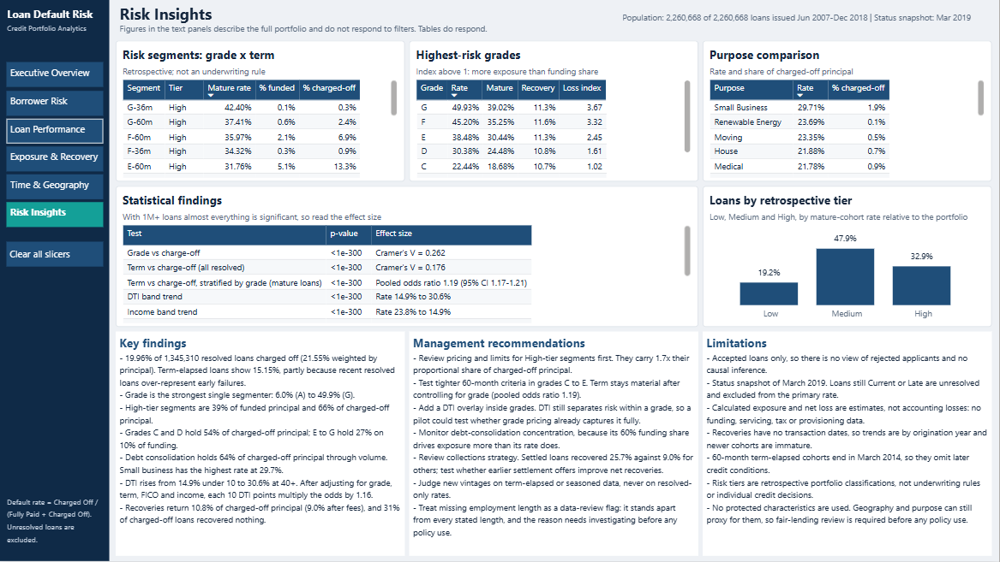
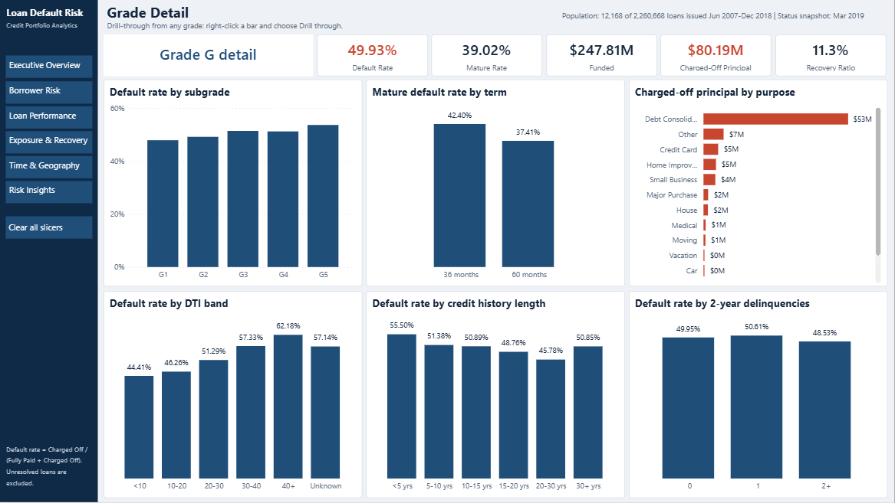

# Loan Default Risk Intelligence & Credit Portfolio Analytics

End-to-end analysis of 2,260,668 LendingClub loans (34.00 billion dollars funded), from a raw 1.6 GB CSV to a validated MySQL database and an interactive Power BI dashboard.



## Business problem

A lender needs to know how its portfolio performed, which segments drove charge-offs, how much was recovered, and which actions merit testing. Getting this right depends on careful definitions: counting unresolved loans or using the wrong denominator produces misleading default rates.

## Key results

| KPI | Value | Definition |
|---|---:|---|
| Loans | 2,260,668 | Issued Jun 2007 to Dec 2018 |
| Funded principal | $34.00B | Original funded amount |
| Historical default rate | 19.96% | Charged Off / (Fully Paid + Charged Off) |
| Principal-weighted rate | 21.55% | Same, weighted by funded dollars |
| Term-elapsed default rate | 15.15% | Loans past scheduled maturity by Mar 2019 |
| Charged-off principal | $3.00B | Funded minus principal repaid; an estimate |
| Recovery ratio | 10.8% | Gross recoveries / charged-off principal |

## Key findings

- 19.96% of 1,345,310 resolved loans charged off (21.55% weighted by principal). Term-elapsed loans show 15.15%, partly because recent resolved loans over-represent early failures.
- Grade is the strongest single segmenter: 6.0% (A) to 49.9% (G).
- High-tier segments are 39% of funded principal and 66% of charged-off principal.
- Grades C and D hold 54% of charged-off principal; E to G hold 27% on 10% of funding.
- Debt consolidation holds 64% of charged-off principal through volume. Small business has the highest rate at 29.7%.
- DTI rises from 14.9% under 10 to 30.6% at 40+. After adjusting for grade, term, FICO and income, each 10 DTI points multiply the odds by 1.16.
- Recoveries return 10.8% of charged-off principal (9.0% after fees), and 31% of charged-off loans recovered nothing.

## Recommendations to test

- Review pricing and limits for High-tier segments first. They carry 1.7x their proportional share of charged-off principal.
- Test tighter 60-month criteria in grades C to E. Term stays material after controlling for grade (pooled odds ratio 1.19).
- Add a DTI overlay inside grades. DTI still separates risk within a grade, so a pilot could test whether grade pricing already captures it fully.
- Monitor debt-consolidation concentration, because its 60% funding share drives exposure more than its rate does.
- Review collections strategy. Settled loans recovered 25.7% against 9.0% for others; test whether earlier settlement offers improve net recoveries.
- Judge new vintages on term-elapsed or seasoned data, never on resolved-only rates.
- Treat missing employment length as a data-review flag: it stands apart from every stated length, and the reason needs investigating before any policy use.

Full evidence is in [the final report](documentation/final_project_report.md).

## Technology

Python (pandas, DuckDB, SciPy, statsmodels, Matplotlib, seaborn), MySQL 8, Power BI Desktop (Power Query, DAX), Jupyter.

## Architecture

```text
Raw CSV (2,260,701 rows, 151 columns)
  -> data_inspection.py    all-text staging Parquet and column audit
  -> data_cleaning.py      typed, flagged, cleaned Parquet (186 columns)
  -> data_validation.py    37 rules
  -> risk_segmentation.py  analytical Parquet with retrospective tiers
  -> eda / borrower / financial / statistical analysis
  -> mysql_export + run_sql      MySQL schema, checks, queries, views
  -> powerbi_export + build_template      star schema and report template
  -> qa_checks.py          Python, MySQL and Power BI reconciliation
```

## Analytical approach

- **Careful definitions.** Current and Late loans are never counted as defaults. The Default status (40 loans) and legacy policy-exception loans are reported separately.
- **Separate denominators.** Count-based, principal-weighted and share-of-originated rates stay separate.
- **Maturity awareness.** Recent resolved loans over-represent early failures, so cohorts are compared only after their terms have elapsed.
- **Reported versus calculated.** Cash fields are distinguished from estimates, and nothing is presented as an accounting loss.
- **Effect sizes.** With over a million loans nearly everything is significant, so readings use effect sizes and stratified tests.
- **Transparent segmentation.** Retrospective grade x term tiers use published thresholds, with no protected characteristics.

Details: [methodology](documentation/methodology.md).

## SQL

35 documented business queries plus data-quality checks and KPI views: joins, CTEs, subqueries, CASE, RANK, DENSE_RANK, NTILE, LAG, running totals and year-over-year change. See [SQL documentation](documentation/sql_documentation.md).

## Dashboard

Six pages plus a drill-through page and a report-page tooltip, with synced slicers, cross-filtering, conditional formatting and 52 documented [DAX measures](powerbi/dax_measures.md).

| | |
|---|---|
|  |  |
|  |  |
|  |  |

## Testing

30 checks passed, 0 failed, 2 not run. See the [testing report](documentation/testing_report.md), including the defects that testing caught and how they were fixed.

## Run it

Download `accepted_2007_to_2018Q4.csv` from [Kaggle](https://www.kaggle.com/datasets/wordsforthewise/lending-club) into `data/raw/`. Then from the project root:

```bash
python -m venv .venv
```

```bash
.venv/Scripts/python -m pip install -r requirements.txt
```

```bash
.venv/Scripts/python python/run_pipeline.py
```

MySQL (set `MYSQL_HOST`, `MYSQL_PORT`, `MYSQL_USER`, `MYSQL_PASSWORD`; the server needs `local_infile` enabled):

```bash
.venv/Scripts/python python/run_sql.py
```

Power BI: run `python powerbi/build_template.py`, open `powerbi/Loan_Default_Risk_Dashboard.pbit`, confirm the `DataFolder` path and choose Load.

## Limitations

- Accepted loans only, so there is no view of rejected applicants and no causal inference.
- Status snapshot of March 2019. Loans still Current or Late are unresolved and excluded from the primary rate.
- Calculated exposure and net loss are estimates, not accounting losses: no funding, servicing, tax or provisioning data.
- Recoveries have no transaction dates, so trends are by origination year and newer cohorts are immature.
- 60-month term-elapsed cohorts end in March 2014, so they omit later credit conditions.
- Risk tiers are retrospective portfolio classifications, not underwriting rules or individual credit decisions.
- No protected characteristics are used. Geography and purpose can still proxy for them, so fair-lending review is required before any policy use.

More in [limitations](documentation/limitations.md).
